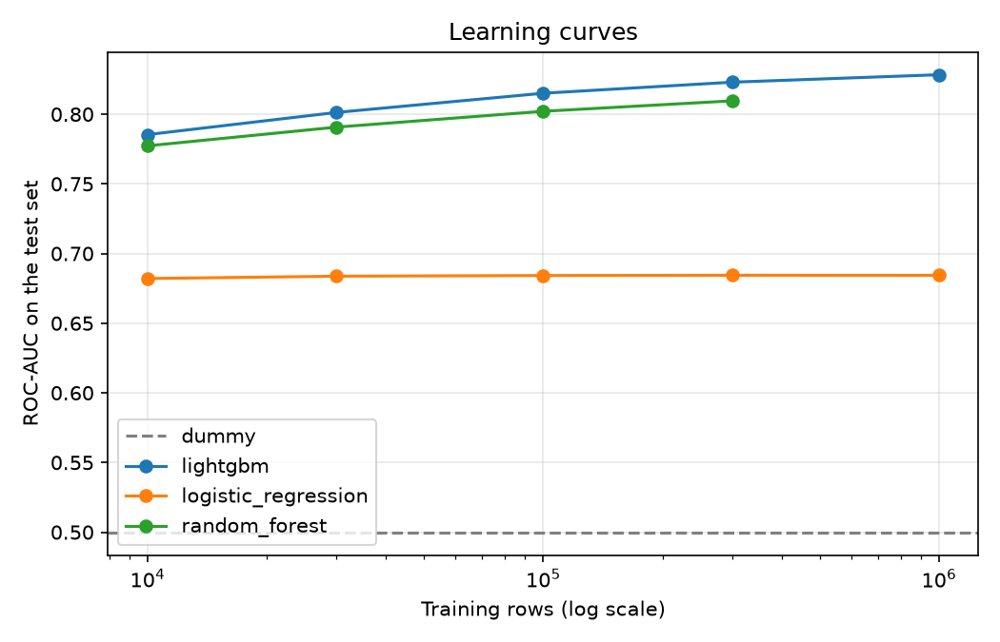

# Higgs Signal vs Background Classification

Final project for the course **Programming for Data Analysis and Database**
(MSc Applied Artificial Intelligence, Astana IT University). Topic 38, Cluster 7:
Machine Learning on Tabular Data.

**Author:** Nurislam Toktarov, group AAI-2602

## Task

The [UCI HIGGS dataset](https://archive.ics.uci.edu/dataset/280/higgs) contains
11 million simulated particle collisions. Each row has a label
(1 = a process that produces a Higgs boson, "signal"; 0 = "background") and
28 numeric features: 21 low-level measurements of the detected particles and
7 high-level features (invariant masses) derived from them by physicists.

The project answers three questions:

1. How to process a file that does not fit comfortably in memory (2.6 GB compressed)?
2. How much training data is actually needed? (learning curves, subsample justification)
3. Which model gives the best trade-off between quality (ROC-AUC), training time and model size?

## Project structure

```
main.py               console menu and command-line interface
src/config.py         paths, column names, experiment settings
src/utils.py          timer, JSON files, saved program state
src/data_loader.py    download, chunked CSV -> Parquet, out-of-core reading and sampling
src/eda.py            data quality audit and exploratory analysis
src/plots.py          all figures (matplotlib + interactive Plotly)
src/database.py       SQLite schema, loading, query runner
src/sql_queries.py    12 analytical SQL queries
src/models.py         pipelines, tuning, learning curves, interpretation
src/predict.py        interactive prediction for a single event
docs/er_diagram.md    ER diagram of the database
```

## How to run

Python 3.10 or newer.

```bash
git clone https://github.com/meaningfullname/Final_AI.git
cd Final_AI
pip install -r requirements.txt
python main.py            # interactive menu
```

Without the menu:

```bash
python main.py --all                    # whole pipeline on the full dataset
python main.py --all --rows 1000000     # quick run on the first 1M rows
python main.py --step sql               # a single step
python main.py --all --no-tuning        # skip the hyperparameter search
```

### Google Colab

```
!git clone https://github.com/meaningfullname/Final_AI.git
%cd Final_AI
!pip install -q -r requirements.txt
!python main.py --all
```

The dataset is downloaded automatically by step 1. If the download fails, get
`higgs.zip` from the dataset page, and put `HIGGS.csv.gz` into the `data/` folder.

The UCI archive can be very slow (about 100 KB/s when this project was run). The
results below were obtained with the same file taken from the dataset authors'
server, `http://mlphysics.ics.uci.edu/data/higgs/HIGGS.csv.gz`. Its size
(2,816,407,858 bytes) and CRC32 (`d7dc54c1`) match the `HIGGS.csv.gz` entry inside
the UCI `higgs.zip`.

### Menu

```
1 - Download the dataset (2.6 GB)
2 - Convert CSV to Parquet in chunks + memory report
3 - Data quality audit and EDA figures
4 - Build the SQLite database
5 - Tune and train models, learning curves
6 - Feature-set comparison, importance, error analysis
7 - Run the analytical SQL queries
8 - Predict a single event
9 - Run steps 1-7 one after another
0 - Exit
```

Completed steps are remembered in `results/state.json` and marked in the menu.

## Method

**Data.** The CSV is read in chunks of 500K rows. Features are converted from
float64 to float32 and the label to int8, and every chunk is written as one
Parquet row group. Later steps read only the row groups they need.

**Split without leakage.** The last 500,000 rows are the test set (the split used
by the dataset authors). Training samples are drawn only from the rows before
them. Imputation and scaling are steps of the scikit-learn pipeline, so their
statistics are learned from training rows only. Hyperparameters are chosen by
3-fold cross-validation inside the training part; the test set is used once per
trained model.

**Models.**

| Model | Role |
|---|---|
| DummyClassifier (class prior) | baseline |
| Logistic Regression | linear model |
| Random Forest | bagging of trees |
| LightGBM | gradient boosting |

**Comparisons.**

- Loading: CSV with default dtypes (baseline) vs CSV with float32 vs Parquet (time, memory).
- Models: ROC-AUC, PR-AUC, accuracy, F1, training time, prediction time, model size.
- Learning curves: the same models on 10K, 30K, 100K, 300K and 1M training rows.
- Feature sets: low-level only vs high-level only vs all 28 features.

**Interpretation.** Permutation importance, confusion matrix, ROC curves,
calibration by deciles (SQL), analysis of events that every model gets wrong (SQL).

## Database

SQLite file `data/higgs.db` with 7 tables. See [docs/er_diagram.md](docs/er_diagram.md).
The 12 queries in `src/sql_queries.py` use JOIN, GROUP BY / HAVING, subqueries,
CTEs and window functions (RANK, LAG, NTILE, MAX OVER). Results are loaded into
pandas and saved to `results/sql/`.

## Outputs

| Path | Content |
|---|---|
| `results/conversion_report.json` | rows, memory before and after dtype optimisation, file sizes |
| `results/format_benchmark.csv` | CSV vs Parquet reading time and memory |
| `results/data_quality_audit.json` | missing values, duplicates, invalid values, class balance |
| `results/descriptive_stats.csv`, `outlier_report.csv` | descriptive statistics and IQR outliers |
| `results/best_params.json` | best hyperparameters and cross-validation AUC |
| `results/experiments.csv` | every training run with metrics, time and size |
| `results/feature_sets.csv` | low-level vs high-level vs all features |
| `results/permutation_importance.csv`, `error_analysis.csv` | interpretation |
| `results/figures/` | 10 PNG figures and 2 interactive Plotly HTML files |
| `results/sql/` | result of every SQL query |
| `models/` | trained models (joblib) |

## Results

Numbers below come from one full run (`python main.py --all`, all 11,000,000 rows)
and are copied from the files in `results/`. The test set is the last 500,000 rows.
Times were measured on a 16-thread laptop CPU and will differ on other machines.

### Data processing

| | Value |
|---|---|
| Rows converted | 11,000,000 in 22 chunks, 56.0 s |
| Memory of the data | 2,434 MB (float64) -> 1,185 MB (float32/int8), 51.3% saved |
| File size | 2,686 MB (`HIGGS.csv.gz`) -> 695 MB (Parquet, snappy) |
| Missing / infinite values, invalid labels, negative values | 0 |
| Fully duplicated rows | 278,698 (2.5%) |
| Signal share | 52.99% (5,829,123 signal, 5,170,877 background) |

Reading the first 1M rows (`results/format_benchmark.csv`):

| Method | Seconds | Memory, MB |
|---|---|---|
| CSV, default dtypes (baseline) | 3.71 | 221.3 |
| CSV, float32 dtypes | 3.81 | 114.4 |
| Parquet | 0.09 | 107.8 |

### Final models

`results/experiments.csv`, rows with `is_final = 1`.

| Model | Train rows | ROC-AUC | PR-AUC | Accuracy | F1 | Train, s | Predict 500K, s | Size, MB |
|---|---|---|---|---|---|---|---|---|
| LightGBM | 1,000,000 | **0.8284** | 0.8428 | 0.7453 | 0.7611 | 11.7 | 1.52 | 4.07 |
| Random Forest | 300,000 | 0.8096 | 0.8250 | 0.7300 | 0.7457 | 37.8 | 0.82 | 67.59 |
| Logistic Regression | 1,000,000 | 0.6844 | 0.6826 | 0.6415 | 0.6875 | 3.4 | 0.11 | 0.004 |
| Dummy (class prior) | 1,000,000 | 0.5000 | 0.5290 | 0.5290 | 0.6920 | 2.3 | 0.10 | 0.004 |

Hyperparameters chosen by 3-fold CV on 100K train rows (`results/best_params.json`):
LightGBM `num_leaves=127, n_estimators=300, learning_rate=0.05, min_child_samples=20,
colsample_bytree=1.0` (CV AUC 0.8092); Random Forest `max_depth=16, min_samples_leaf=20,
max_features=0.5` (CV AUC 0.7978); Logistic Regression `C=10` (CV AUC 0.6843).

### Learning curves

ROC-AUC on the test set by number of training rows.



| Train rows | Logistic Regression | Random Forest | LightGBM |
|---|---|---|---|
| 10,000 | 0.6821 | 0.7773 | 0.7854 |
| 30,000 | 0.6837 | 0.7907 | 0.8013 |
| 100,000 | 0.6842 | 0.8021 | 0.8151 |
| 300,000 | 0.6844 | 0.8096 | 0.8230 |
| 1,000,000 | 0.6844 | not trained | 0.8284 |

### Feature sets

LightGBM trained on 300,000 rows (`results/feature_sets.csv`).

| Features | Count | ROC-AUC | Difference vs all |
|---|---|---|---|
| All | 28 | 0.8221 | - |
| High-level only | 7 | 0.7875 | -0.0345 |
| Low-level only | 21 | 0.7276 | -0.0944 |

### Conclusions

1. **Large file.** Chunked conversion to Parquet with float32/int8 halves the memory
   (2,434 -> 1,185 MB) and makes reading 1M rows about 40 times faster than from CSV
   (0.09 s vs 3.71 s). Setting float32 dtypes while reading CSV saves memory but not time.
2. **How much data.** Logistic Regression is saturated at 10K rows: 100 times more data
   adds 0.002 AUC. The tree models keep improving, with shrinking steps: for LightGBM
   every roughly threefold increase adds 0.016, 0.014, 0.008 and 0.005 AUC, so the curve
   has not flattened at 1M rows. A 300K sample gives 0.8230, which is 0.005 below the
   1M result at a third of the training time.
3. **Best trade-off.** LightGBM is the best on every quality metric and is also cheaper
   than Random Forest: on the same 300K rows it reaches 0.8230 vs 0.8096 AUC, trains in
   3.9 s vs 37.8 s and takes 4.0 MB vs 67.6 MB. Logistic Regression is the smallest and
   fastest, but 0.14 AUC behind, so a linear boundary is not enough for this task.
4. **Features.** The 7 high-level features alone (0.7875) beat the 21 low-level ones
   (0.7276), but the best result needs both (0.8221). Permutation importance agrees:
   the high-level features account for 0.346 of the total AUC drop against 0.117 for
   the low-level ones, and the top three are `m_bb`, `m_wwbb`, `m_wbb`.
5. **Errors.** The best model misclassifies 25.47% of the test events (65,678 false
   positives, 61,651 false negatives). Only 2.5% of these errors are made with a
   probability above 0.9 or below 0.1. The predicted probabilities are close to the
   observed signal share in every decile (for example 0.083 predicted vs 0.063 actual
   in the lowest decile and 0.938 vs 0.958 in the highest; computed in SQL on the
   100,000 test events stored in SQLite).

## Limitations

- The data is simulated, not recorded by a real detector.
- Random Forest is trained on at most 300K rows because of training time
  (`RF_MAX_TRAIN` in `src/config.py`).
- Only a 200K-event sample is stored in SQLite; the full data stays in Parquet.
  The SQL confusion matrix, calibration and hard-event queries therefore cover
  100,000 of the 500,000 test events.
- The dataset contains fully duplicated rows, and the positional split does not
  remove them. A separate check after the full run found that 23,911 test rows (4.8%)
  have an identical row somewhere in the train part, and 2,390 (0.5%) in the 1M sample
  the final models were trained on. The split was left as defined by the dataset authors.
- Every number comes from a single run with one random seed; no confidence
  intervals were computed.

## References

- Baldi, P., Sadowski, P., Whiteson, D. Searching for exotic particles in
  high-energy physics with deep learning. *Nature Communications* 5, 4308 (2014).
- Whiteson, D. HIGGS dataset. UCI Machine Learning Repository (2014).
  https://archive.ics.uci.edu/dataset/280/higgs
