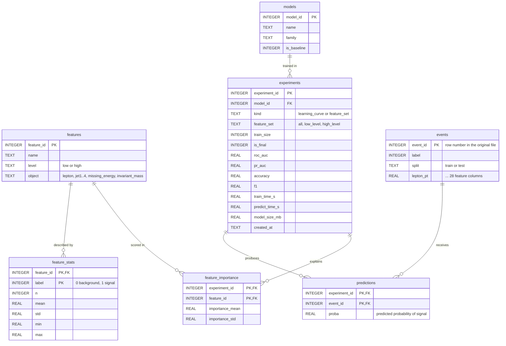

# ER diagram of the SQLite database (`data/higgs.db`)

## Tables

| Table | Rows | Purpose |
|---|---|---|
| `features` | 28 | Reference table of features with their level and physical object |
| `feature_stats` | 56 | Mean, std, min, max of every feature per class, computed over the whole dataset |
| `events` | up to 200,000 | Sample of events: first 100K train rows and first 100K test rows |
| `models` | 4 | Reference table of models, including the baseline |
| `experiments` | one per training run | Metrics, time and model size of every run |
| `predictions` | final models x stored test events | Predicted probability of signal |
| `feature_importance` | 28 | Permutation importance of the best model |

Only a sample of events is stored in SQLite. The full 11M rows stay in Parquet,
which is the right format for column-wise numeric reads; SQLite holds the
relational part of the project (reference tables, experiments, predictions).
